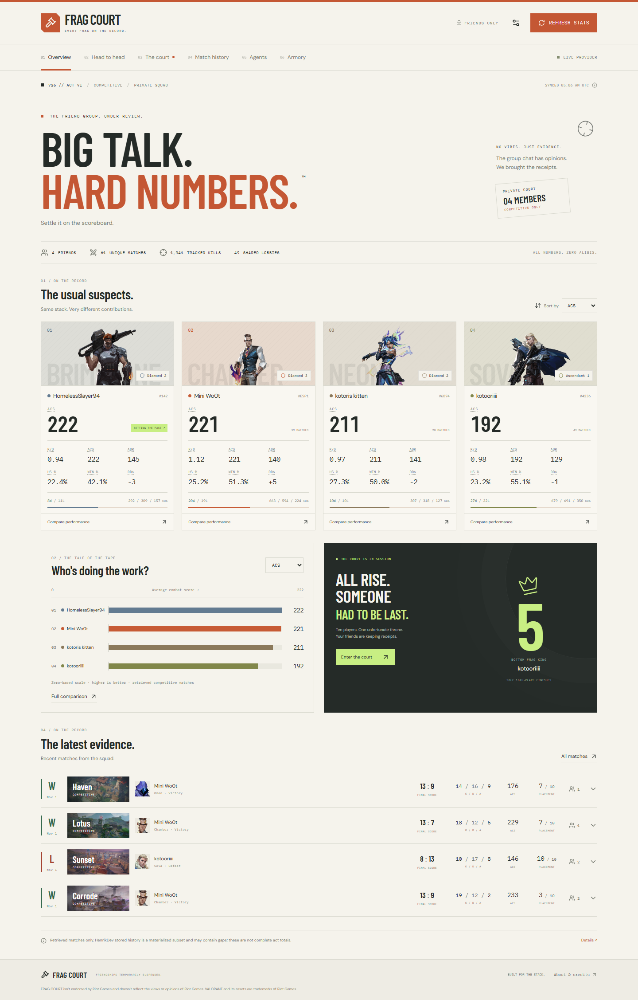

# FRAG COURT

**Big talk. Hard numbers.** A VALORANT statistics dashboard for a small friend group, with an editorial scoreboard design and a very opinionated court.



## Run locally

Requires **Node.js 22.13+** (Node 24 LTS recommended).

```sh
npm ci
npm run setup:live
npm run dev
```

On Windows PowerShell:

```powershell
npm.cmd ci
npm.cmd run setup:live
npm.cmd run dev
```

Open **http://127.0.0.1:3000** and use the app directly. No login, username or password is required. The four real accounts below are already configured. The secure setup command validates your server's HenrikDev key, saves it only in ignored `.env.local`, and enables live mode and automatic region detection. Visitors never enter the provider key.

If you do not have a key yet, run `npm run dev` and use the connection screen. The complete offline exhibition remains available at **http://127.0.0.1:3000/?demo=1** without API credentials. Its 36 fictional matches are deterministic and are never assigned to your real accounts. SQLite is created automatically in `data/`.

## What works

- Overview: sortable player cards; weighted ACS, K/D, ADR, win rate, hit-based HS%, damage delta, W/L and K/D/A totals.
- Home reputations: Trade Surplus (best total K/D), Exit Interview (worst total K/D), Main Character Clause (most lobby MVPs), Basement Residency (most sole bottom finishes), and Metronome (lowest relative ACS variation, minimum three matches). Tap a title for its evidence and calculation. Ties share titles; empty samples earn none.
- Partners in Crime: two disjoint duo pairings chosen from same-team results, with a three-game minimum and sample-adjusted win rates. The illustrated squad cart assigns its puller from combat-score advantage over tracked teammates in the latest ten shared games. Faces follow player names; titles, pairings and the driver recalculate when refreshed data arrives. Motion can be paused and respects reduced-motion preferences.
- Head to head: zero-based comparative bars, signed damage deltas, a side-by-side table, ACS trends, and agent leaders with a five-match threshold.
- The Court: full-lobby Bottom Frag King, Match MVP, kill leader, friend-group carry and liability, plus a K/D tab for best and worst kills-to-deaths ratio per match, excluding assists. Inspect each player's contributing matches.
- History: unique shared matches, player/map/result filters, pagination, and ten-player scoreboards with tracked-friend highlights.
- Agents: weighted per-agent aggregates, sample indicators and cross-friend comparisons.
- Armory: actual all-weapons hit-region counts. Weapon-specific metrics explicitly remain unavailable.
- Refresh: persistent SQLite cache, ID deduplication, PUUID resolution cache, cross-process locking, provider retries and rate-limit handling.
- Dark mode throughout the app, including charts, scoreboards, dialogs and native controls; direct access without sign-in, reduced-motion support, mobile layouts, data coverage details and JSON export.

## Live data

The live adapter uses documented **HenrikDev v4 match details**, v1 stored history, v2 account resolution and v3 MMR. The roster in [`src/config/players.ts`](src/config/players.ts) is:

- `Mini Wo0t#ESP1`
- `HomelessSlayer94#142`
- `kotoris kitten#6874`
- `kotooriiii#4236`

The operator confirmed the four owners' consent. Provider-required authorization is separate. Use `npm run setup:live` after obtaining permitted key access, or manually configure the ignored `.env.local`:

```dotenv
DATA_PROVIDER=henrik
HENRIK_API_KEY=your_server_only_key
HENRIK_AUTHORIZED=true
VALORANT_REGION=auto
VALORANT_PLATFORM=pc
```

Restart the server, then click **REFRESH STATS**. PUUIDs are cached after initial resolution; you may also configure them directly. Auto region mode resolves each account's actual region, including cached identities. Main-agent artwork is derived from imported matches instead of guessing each friend's agent. Current act IDs are never hardcoded. Act dates and type come from VALORANT-API and the ID is verified against provider content before ingestion. Unknown or expired acts fail closed.

Live account resolution, ranks, current-act match ingestion and rendering have been verified with a real key. The key and SQLite cache are local only; a fresh checkout or deployment needs its own server environment configuration. Rate-limited refreshes wait for the provider's reset window and preserve partial imported progress. Retrieved coverage remains explicit.

**Authorization matters:** an unofficial API key alone does not establish permission. HenrikDev's dashboard terms and Riot's applicable requirements must permit the actual deployment and all tracked players must supply the required opt-in. `HENRIK_AUTHORIZED` records the operator's acknowledgement; it is not OAuth or proof of authorization. See [`docs/PROVIDERS.md`](docs/PROVIDERS.md).

Riot's official adapter is an explicit future boundary, not a working integration. Riot currently excludes private personal applications, and approved integrations require a production key and RSO. Selecting `riot` displays that limitation and never silently falls back to fictional data.

**Unavailable metrics:** per-weapon head/body/leg hit percentages, per-weapon damage distribution and weapon-specific performance. Current rank and global hit/damage stats can also be unavailable for individual provider responses. Missing metrics are not synthesized. Retrieved history may have holes; live aggregates are never labeled complete act totals.

## Verification

```sh
npm test
npm run typecheck
npx playwright install chromium
npm run test:e2e
npm run build
```

The Playwright suite starts an isolated fixture server and test database. Stop your regular dev server first, since Next.js allows one dev server per checkout. It runs desktop and mobile flows without credentials, checks connection setup and explicit demo selection, navigation, filters, comparisons, scoreboard expansion, award evidence, agent switches, Armory availability, persistent refresh results, hash links, reduced motion and cross-origin rejection. Screenshots are saved in `artifacts/`. The fixture server never reads or overwrites the live cache.

The unit suite tests weighted math, all award types, ties, single-friend lobbies, shared/duplicate matches, incomplete lobbies, act boundaries, missing statistics, draws, provider normalization and privacy, bounded rate-limit behavior, SQLite deduplication, provider/act isolation, locks and identity resolution.

The completed validation results and remaining external limitations are recorded in [`docs/VERIFICATION.md`](docs/VERIFICATION.md).

## Share with friends

Use a **single Node server or Docker container with a persistent disk**. The current local SQLite architecture needs a writable, durable filesystem. A stateless or static-only host cannot preserve its cache without adapting storage.

1. Configure the host's environment for the live data provider. There is no visitor authentication to set up.
2. Set `DATA_PROVIDER` and live credentials only on the server. Keep the API key out of Git and client environment variables.
3. Mount persistent storage at `/app/data` (Docker) or set `DATABASE_PATH` to a durable path.
4. Build and run:

```sh
npm ci
npm run build
npm start
```

Visitors can open the URL directly without a password or sign-in. Use HTTPS on your host. Provider-required player opt-in and server API authorization remain separate from visitor access.

Docker alternative:

```sh
docker compose up --build -d
```

Set the provider values in `.env.local` first. Place the container behind an HTTPS reverse proxy. See [`docs/DEPLOYMENT.md`](docs/DEPLOYMENT.md) for persistence, backups, proxy configuration and scale limits.

## Architecture & design

Next.js App Router + TypeScript + React; handcrafted CSS tokens and layouts; custom SVG charts; `node:sqlite` for persistence; Zod at provider boundaries; Node's test runner; Playwright. Custom CSS is used instead of a component kit or Tailwind to keep the visual system direct and dependency-light. All fonts and artwork are local at runtime.

[`docs/ARCHITECTURE.md`](docs/ARCHITECTURE.md) explains award and aggregate rules. [`docs/PROVIDERS.md`](docs/PROVIDERS.md) records the researched endpoints, limitations and policy sources. [`public/ASSET-CREDITS.md`](public/ASSET-CREDITS.md) lists artwork and font attribution.

This project is not endorsed by Riot Games. VALORANT and its assets belong to Riot Games.
